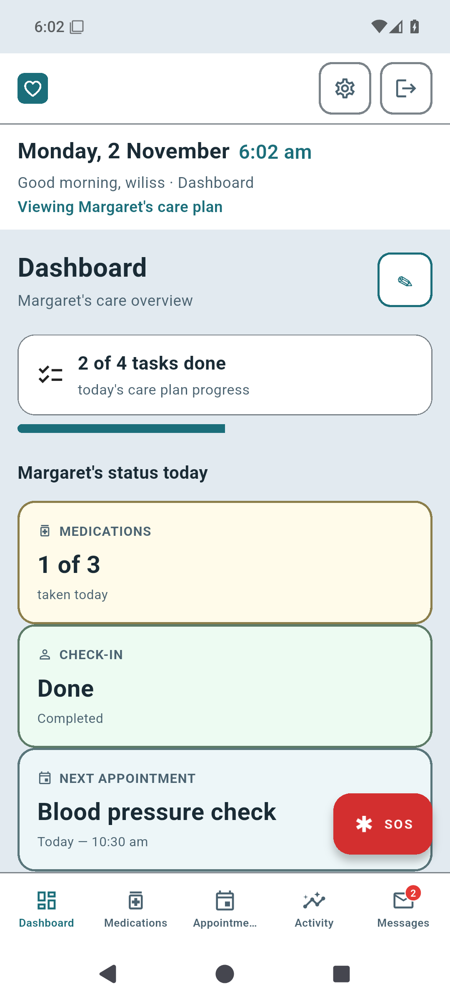
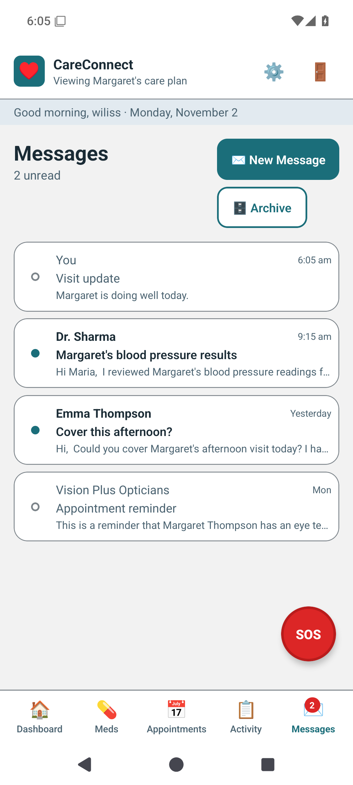
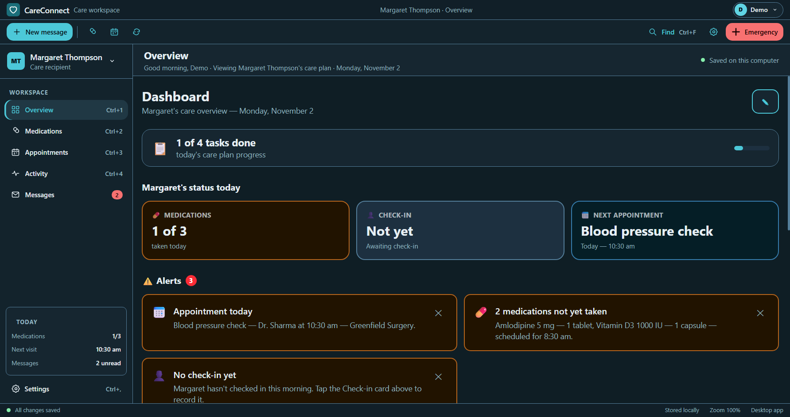
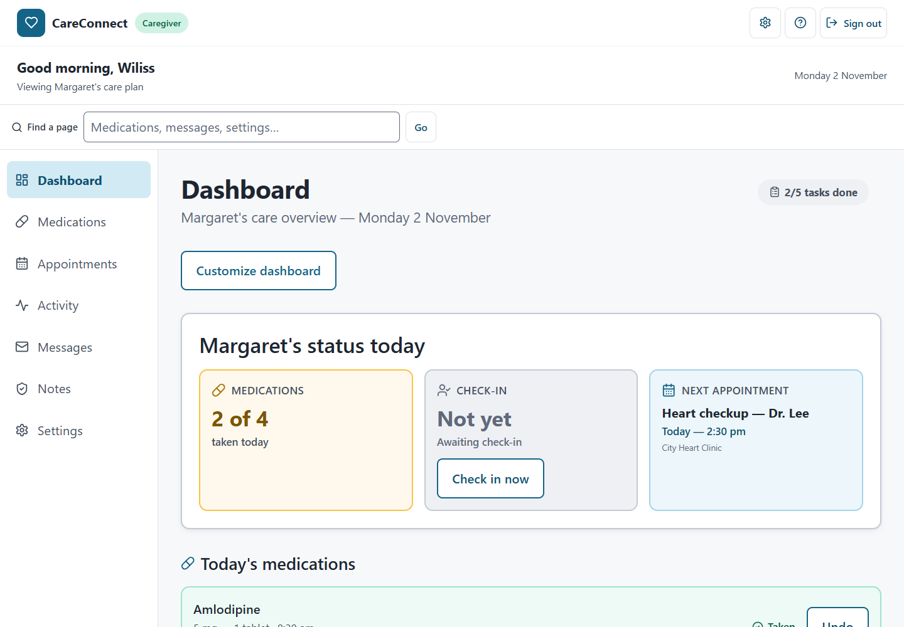
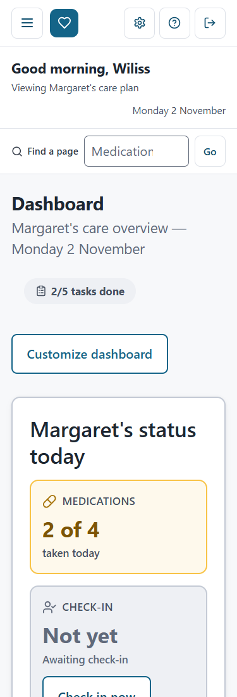
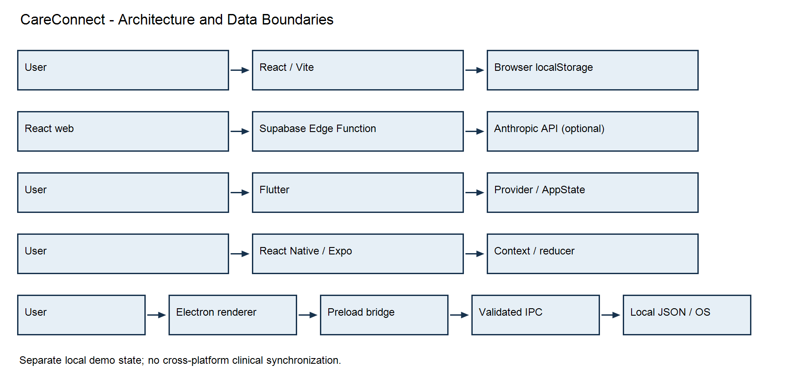

# Section 3: Complete Documentation

SWEN 661 - Team 1 - Week 12

## 3.1 User Documentation

### Purpose and intended use

CareConnect is an educational care-coordination prototype with React web, Flutter mobile, React Native mobile, and Electron desktop implementations. Users can explore a daily overview, medications, appointments, activity, messages, and accessibility-oriented settings. Features vary by platform.

Use fictional demonstration information only. CareConnect is not a medical device, medical-advice service, secure patient-record system, or emergency service. Authentication is a demonstration; the applications do not synchronize care plans or deliver messages to real clinicians.

### Installation and access

| Platform | How to access/install | Limitations |
|---|---|---|
| Web | Open https://laowai-fi.github.io/careconnect-swen661-T1/ in a modern browser. In Chrome/Edge, use Install app when available. Visit online and allow the service worker to become ready before trying offline reload. | Browser-local demonstration data; installation options depend on browser/OS. Production verification records an offline reload, not a physical phone installation. |
| Flutter Android | Obtain `CareConnect-Flutter-Week12.apk` from the team's separately supplied final package. Transfer/install using the course-approved Android process. | Course release-mode APK uses development signing, not a store release. iOS requires macOS/Xcode and signing; no final IPA is established by the delivery record. |
| React Native Android | Obtain `CareConnect-ReactNative-Week12.apk` from the final package. It is standalone: Metro and Expo Go are not needed. | Recorded support includes arm64 and x86_64. Course development signing is used. No final iOS IPA is established by the delivery record. |
| Electron Windows | Verify `CareConnect-Setup-0.8.0.exe` against the supplied `SHA256SUMS.txt`, run setup, and launch CareConnect. | Not presented as a publicly signed commercial release. Packaged executable verification does not establish that the installer UI was tested. |
| Electron macOS | Obtain the Apple Silicon or Intel workflow artifact linked in the delivery guide, extract it, and use the matching DMG. | Unsigned/not notarized. GitHub login may be required and artifacts expire. Retain the download before expiration. |
| Electron Linux | Build the Linux distribution using the desktop README and `npm run dist:linux`. | A final Linux installer is not listed in the final package. The assignment requires one desktop platform, not all three. |

If Android reports a signature conflict with an older course APK, uninstalling the old build may be necessary; this removes its local demo data. Obtain packages only from the trusted team distribution.

Final build filenames and installation instructions: https://github.com/LaoWai-Fi/careconnect-swen661-T1/blob/main/docs/week12/DELIVERY.md

### First use and key features

1. Launch the application and sign in/sign up using fictional information.
2. Open Dashboard/Today to review the sample care plan and upcoming items.
3. Use navigation to access medications, appointments, activity, and messages.
4. Review details before saving a form or confirming deletion. Medication status can be changed through the available controls.
5. Explore settings for larger text, theme, and left/right-hand controls where available.

Messages and check-ins are demonstration interactions, not delivery to clinicians. Flutter and React Native use in-memory mobile state; Electron persists a device-local care plan; web uses browser storage. There is no cross-device synchronization. Electron provides care-plan import/export and native menus/shortcuts. Do not treat local state or exported JSON as a secure clinical record.

The SOS control is a prototype action that asks for confirmation and opens the device dialer where supported. CareConnect cannot place or verify a call. Do not activate emergency calling during course demonstrations; use the device's normal emergency workflow when needed.

### Accessibility guidance

Use labeled controls and available text-size, theme, and hand-mode settings. Web and desktop provide keyboard navigation and focus-managed dialogs; Electron additionally provides native shortcuts. Mobile offers labeled touch controls and button alternatives for dashboard reordering.

Week 6 records Android TalkBack walkthroughs; Week 8/9 records desktop macOS keyboard and VoiceOver checks. Week 12 Part 1 records web keyboard and VoiceOver/Safari checks. Final release-APK automated workflows and packaged Windows keyboard verification add functional evidence, not new screen-reader listening results. Mobile iOS VoiceOver and Windows NVDA remain unverified in the reviewed records.

VoiceOver/Safari did not speak the web appointment-deletion status on the recorded retest. The result remains visible, but visual checking is not an equivalent workaround for a blind user. Do not rely on speech for this particular confirmation or claim the limitation is fixed without a genuine retest.

The three VPATs below identify criterion-specific support, limitations, and pending checks. Themes and coverage percentages alone do not prove WCAG conformance.

### Week 12 application screenshots

The following images are the team's existing Week 12 evidence on `main`. Reusing them does not claim a new capture or test session.

Figure U1. Flutter application screenshot from the team's final integration evidence.

Figure U2. React Native application screenshot from the team's final integration evidence.

Figure U3. Packaged Electron Windows dashboard from the team's final verification evidence.

Figure U4. Deployed React web dashboard at desktop width (top-of-page crop for readability).

Figure U5. Deployed React web dashboard at narrow width (top-of-page crop for readability).

Source images: https://github.com/LaoWai-Fi/careconnect-swen661-T1/tree/main/docs/week12/evidence

### FAQ and troubleshooting

**Is sign-in a real account service?** No. Use demonstration details; no production password recovery is documented.

**Does information synchronize between platforms?** No. Each application has separate local demonstration state.

**Why does the Android APK refuse to replace an older build?** Signing may differ. Follow the delivery guide; uninstalling an old build removes its data.

**Why does the desktop installer show a warning?** Course builds are not presented as signed commercial releases. Confirm the trusted source and checksum before installing.

**How do I try the web app offline?** First visit online, wait for service-worker readiness, then reload offline. Installation and offline capability are separate from complete accessibility conformance.

**What should I do if controls are hard to read or operate?** Try available text-size/theme/hand-mode settings and supported keyboard controls. Consult the VPAT for unresolved issues; do not assume a setting fixes every accessibility problem.

**Why does the assistant give limited replies?** It is limited to onboarding and explaining CareConnect, not medical advice. It may use scripted responses when the optional remote service is unavailable.

**Can I use CareConnect for care decisions or emergency calls?** No. Consult appropriate professionals and use normal emergency services.

## 3.2 Developer Documentation

### Architecture

The repository contains independently configured applications with separate local data. The optional web onboarding assistant is the documented remote API integration. Electron separates the sandboxed renderer from OS/file access through its preload bridge and validated IPC.

Figure D1. Platform architecture. Arrows represent interaction/data flow, not cross-platform synchronization.

### Code structure

| Folder | Responsibility |
|---|---|
| `web` | React/TypeScript/Vite pages, shared controls, routing, demonstration authentication, browser-local data, and service worker. |
| `mobile-flutter` | Flutter screens/widgets, theme, Provider/AppState, routes, and sample data. |
| `mobile-rn` | React Native/Expo screens/components, React Navigation, Context/reducer state, and theme. |
| `desktop-electron` | Electron main/preload, React renderer, validated IPC, native menus, local care-plan storage, tests, and packaging. |
| `docs/week12` | Final integration/delivery records, evidence, coverage reports, and documentation. |

### Prerequisites and setup

Use Git, Node 22.12+ and npm for web/desktop, Node 22 and Android tooling for React Native, and Flutter/Java/Android tooling for Flutter. The final checkout guide records Flutter 3.47.8 and Java 17 for CI. iOS development requires macOS/Xcode and signing.

Clone https://github.com/LaoWai-Fi/careconnect-swen661-T1.git and check out the team's approved final revision. Record the SHA when producing evidence. Install dependencies within each platform folder using its lockfile.

| Platform folder | Setup/development | Verification |
|---|---|---|
| `web` | `npm ci`; `npm run dev` | `npm run lint`; `npm run test:coverage -- --runInBand`; `npm run build`; `npm run test:e2e`; `npm run preview` |
| `mobile-flutter` | `flutter pub get`; `flutter run` | `flutter test --coverage`; `flutter build apk --release` |
| `mobile-rn` | `npm ci`; `npx expo start` for development | `npm run coverage -- --runInBand`; `npx expo prebuild --platform android --no-install`; use the release Gradle task in the final mobile workflow |
| `desktop-electron` | `npm ci`; `npm start` | `npm run typecheck`; `npm run lint`; `npm run test:coverage -- --runInBand`; `npm run test:e2e`; `npm run dist:win` |

Web E2E starts its own preview; free port 4173 first. Windows Chromium tests default to installed Edge in the final guide. Other hosts require Playwright browser installation for configured engines. Do not combine historical full-browser results with the final local Edge run as if they were one run.

Release-APK Maestro commands: `maestro test --format junit --output results.xml --test-output-dir maestro-output maestro/`. Install both course release APKs on the target emulator/device before running those workflows.

Authoritative current checkout instructions: https://github.com/LaoWai-Fi/careconnect-swen661-T1/blob/main/docs/week12/FRESH_CHECKOUT_GUIDE.md

### API and data safety

The optional web assistant calls `POST {VITE_SUPABASE_URL}/functions/v1/chat-assistant`. Requests contain a `messages` array with `role` and `content`. Responses contain `reply` or `useFallback`; malformed requests return HTTP 400. The client can use scripted replies on API errors.

Keep `ANTHROPIC_API_KEY` in server-side Supabase secrets, never a `VITE_` client variable. No production care-plan API, real authentication, cross-platform clinical synchronization, or remote messaging is claimed. Electron's care-plan JSON is local demonstration data. Never use real patient information in tests or recordings.

### Final testing and coverage

These are the team's reported Week 12 final records on `main`, not tests newly run for this documentation update.

| Platform | Recorded final tests | Line coverage |
|---|---|---|
| Flutter | 129 Flutter tests | 93.89% (2043/2176) |
| React Native | 135 Jest/RNTL tests | 85.90% (518/603) |
| Electron | 224 Jest tests; 5 Windows Electron E2E tests | 98.44% (1389/1411) |
| Web | 135 Jest/RTL tests; 162 Edge browser tests | 94.56% (922/975) |

All six Maestro workflows passed on the installed release APKs on an Android API 35 Pixel 6 emulator after initial failures were repaired and rerun. Four deployed Landing/Dashboard mobile/desktop Lighthouse audits recorded accessibility 100. A production offline reload passed with no browser manifest/installability errors. These records do not establish new complete route-wide production WAVE/axe scans, physical-phone installation, or new assistive-technology listening sessions.

HTML coverage and raw evidence are linked from https://github.com/LaoWai-Fi/careconnect-swen661-T1/blob/main/docs/week12/README.md

### Deployment by platform

| Platform | Build/distribution |
|---|---|
| Web | Build using `npm run build`; deploy `web/dist` using the repository's hosting configuration. The live URL is https://laowai-fi.github.io/careconnect-swen661-T1/. Verify service-worker readiness, offline behavior, and installability on the actual deployment. |
| Flutter | `flutter build apk --release`; AAB/IPA production requires the appropriate build/signing process. The supplied course artifact is `CareConnect-Flutter-Week12.apk`. |
| React Native | Expo prebuild plus the Android release Gradle task recorded in the mobile workflow; supplied artifact is `CareConnect-ReactNative-Week12.apk`. Expo Go is a development option, not required for that standalone APK. |
| Electron | Windows: `npm run dist:win`; macOS: `npm run dist:mac:arm` or `npm run dist:mac:intel`; Linux: `npm run dist:linux`. The final package lists the Windows installer; matching Mac artifacts are linked in the delivery guide. Signing/notarization limitations remain. |

Retain source SHA, checksums, raw results, and artifact files. GitHub workflow artifacts may expire or require login. The final source ZIP and binaries are supplied separately; filenames do not establish public download URLs.

## 3.3 VPAT Accessibility Conformance Reports

The following desktop, combined Flutter/React Native mobile, and React web reports cover all 50 WCAG 2.1 Level A and AA success criteria. Historical testing dates and unresolved limitations are retained. Final build/coverage evidence supplements the reports but does not convert pending accessibility checks into passes.
