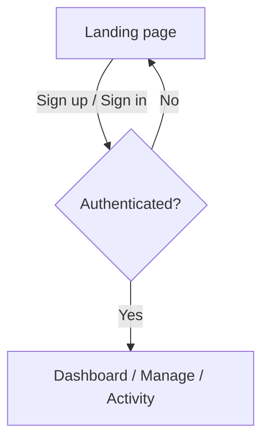
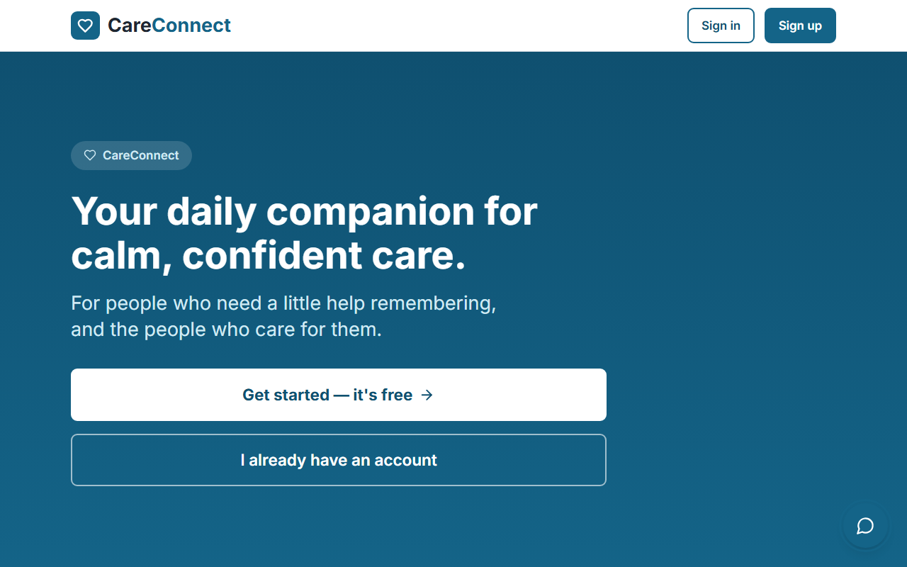
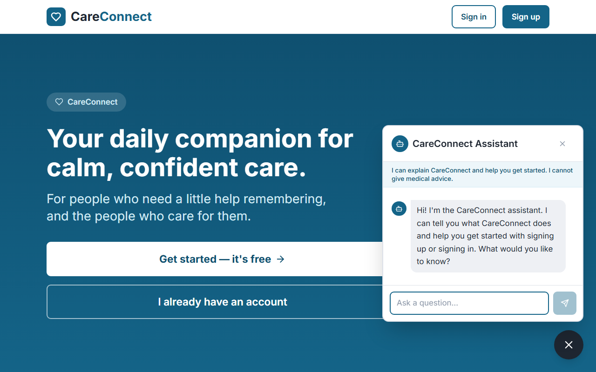
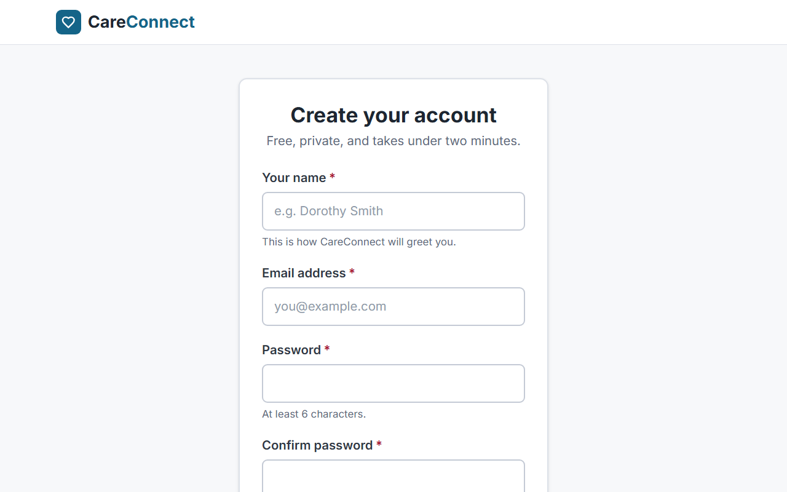
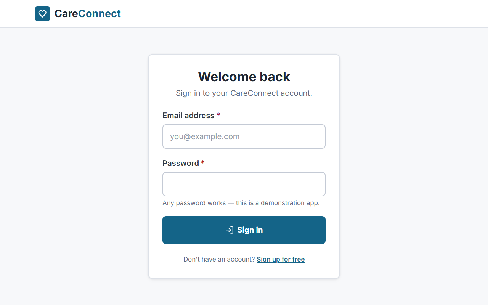

CareConnect


A responsive course-prototype web application for caregivers. Built with React, Vite and React Router, with a PWA foundation and accessibility patterns targeting WCAG 2.1 AA.

### Cross-browser testing

`npm run test:e2e` runs the Playwright suite in Chromium, Firefox and WebKit (install them once with
`npx playwright install chromium firefox webkit`). Use `npm run test:e2e:chromium` for a quick run.
Results and evidence files go to `test-results/`, which is git-ignored. Run `npm run test:e2e:evidence`
only when you intend to refresh the committed evidence in `docs/week11/evidence`.

- PWA install and offline-cache tests run in Chromium only, because installability is defined there.
- Seven tests are skipped in WebKit, each with its reason shown in the test report. Playwright's WebKit on
  macOS does not Tab to links and buttons by default, does not report some focus restoration, and cannot
  navigate offline through a service worker. These behaviours pass in Chromium and Firefox. Spot-check them
  in Safari by hand: skip link, drawer and dialog focus containment, Escape returning focus to the opener,
  and offline reload of a direct route.

## Project conventions

The web app is a caregiver-only experience and follows the WebUIBuild-Revised design build. Some code in this folder came from the original generated starter and no longer matches that design, so it has been removed to keep the app consistent. Please keep these decisions in place when adding features:

- **One experience: the caregiver.** There is no role selector and no "Switch role" control. Sign-in and sign-up go straight to the caregiver dashboard at `/app`. The `/role` route, the role chooser page and the role stored in the session were removed.
- **No care recipient (patient) screens.** The recipient-facing pages (Today, Schedule, Medications, Appointments, Memories and the home page) and their navigation were removed. Please do not add functionality that splits the app into caregiver and care recipient views. It would move the app away from the WebUIBuild-Revised design.
- **Care-plan tracking happens on the caregiver dashboard.** Medications are marked taken (and unmarked) in Today's medications, the daily check-in is recorded from the status card, and each action adds an entry to the activity log. Data lives in `localStorage` through `src/data/caregiverStore.ts`, `medsStore.ts` and `apptStore.ts`.
- **Deployment.** The build supports serving from a sub-path (`VITE_BASE`) for GitHub Pages. Use `import.meta.env.BASE_URL` and router-relative links instead of hard-coded absolute asset paths. See the GitHub Pages section below.
- **Remaining design features** (messages, hand mode, dashboard widgets, theme and font size) are to be ported from WebUIBuild-Revised into this structure, not rebuilt as separate views.

## Week 11 current implementation

See the [Part 1 implementation report](../docs/week11/PART1_IMPLEMENTATION.md), [responsive screenshots](../docs/week11/PART1_SCREENSHOTS.md) and [verified results](../docs/week11/TEST_RESULTS.md). Messages, saved themes/text size/one-handed controls, keyboard dashboard customization and page search/help are implemented. This supersedes the earlier remaining-design note above. Messages are local demonstrations, not real delivery. The complete generated Jest report is [coverage/lcov-report/index.html](coverage/lcov-report/index.html).

Run `npm ci`, `npm run lint`, `npm run test:coverage -- --runInBand`, `npm run build` and `npm run test:e2e`. To view locally, use `npm run preview` after building. Tests start their own preview and require port 4173 free. Non-Windows hosts need `npx playwright install chromium`; Windows defaults to installed Edge. `PLAYWRIGHT_CHANNEL` overrides that selection. Sign-up now opens the caregiver dashboard directly without a role chooser. The PR checks workflow saves test evidence as an artifact. Word preparation was deferred; the report and native screenshots are provided for the team to embed in its final document.

## Week 10 historical contribution

Current deliverables: [web accessibility documentation](../docs/week10/PART2_WEB_ACCESSIBILITY.md), [implementation summary](../docs/week10/PART4_IMPLEMENTATION.md), [PWA behavior and deployment](../docs/week10/PWA_IMPLEMENTATION.md), and [actual test results](../docs/week10/TEST_RESULTS.md).

Use Node.js 22.12+ and run `npm ci`, `npm run build`, and `npm run preview -- --host 127.0.0.1 --port 4173`. The production build generates the service worker; development mode intentionally does not register it. To run the complete browser suite, stop the manual preview server and run `npm run test:e2e`; it starts its own preview. On Windows the tests use installed Edge; `PLAYWRIGHT_CHANNEL=chrome` selects installed Chrome. Screenshots and axe JSON are saved in `docs/week10/evidence/` at the repository root.

Create a fictional demo account, choose Caregiver, then use Dashboard and Medications. Sign-in is local mock authentication: passwords are neither stored nor verified. No backend keys are needed for the core pages. The optional remote assistant has a local scripted fallback.

The older screenshots below illustrate existing features; the Week 10 evidence folder contains the current screenshots and verified test scope. The historical architecture diagram is illustrative; current routing is in `src/App.tsx`, registration in `src/pwa/registerSW.ts`, and the generated worker comes from `public/sw.js` plus `scripts/build-pwa.mjs`.

> Developed as a course artifact for **SWEN 661 — UI Implementation** (Assignment 10: Web Design & Early Implementation).

> **This is the `web/` subproject of the [CareConnect monorepo](../README.md)**, which also contains the Flutter, React Native, and Electron implementations built later in the semester.

---

Table of contents
About
Who it's for
Key features
Accessibility
Tech stack
Project structure
Application flow
Getting started
Available scripts
Screens & walkthrough
Testing
Deployment
Roadmap
Authors
License
Acknowledgments
Disclaimer

---

About
CareConnect gives caregivers clear visibility and control over the medications and appointments of someone who needs a little help remembering. The caregiver dashboard shows adherence, alerts and recent activity in one place, and every screen is built to be keyboard-operable and screen-reader friendly.
Who it's for
Caregivers (family members or professional carers) who manage a loved one's medications, appointments and daily activity.
Key features
Dashboard with adherence summary, an alerts region for missed/overdue items, and a recent-activity timeline.
Manage medications and manage appointments with accessible create/edit forms, inline validation, and delete confirmation.
Activity log and caregiver notes with priority flags.
Public landing page with an accessible, scoped AI assistant (explains the app and guides sign in/up; never gives medical advice).
Installable PWA with offline access to the care plan.
Accessibility
CareConnect is designed and verified against 21 WCAG 2.1 A/AA success criteria, with full conformance mapping in `ACCESSIBILITY.md`.
Highlights: 4.5:1 text contrast, full keyboard operability, visible focus indicators, semantic landmarks, ARIA live regions (`role="status"` / `role="alert"`), 44x44px minimum targets, 320px reflow with no horizontal scroll, and `prefers-reduced-motion` support.
Tech stack
Layer Technology
Framework React 18 + Vite
Language TypeScript (strict)
Styling Tailwind CSS with accessibility-first design tokens
Routing React Router (protected routes)
State / persistence React Context + `localStorage` (mock data)
AI assistant Anthropic API via a serverless/edge function
PWA Web App Manifest + Service Worker
Testing Jest + React Testing Library + Playwright (E2E)

---

Project structure

```
web/
├── public/
│   ├── icons/                       # PWA maskable icons
│   ├── manifest.webmanifest         # PWA manifest
│   └── favicon.svg
├── docs/
│   └── screenshots/                 # README images (01-landing.png … 14-caregiver-activity.png)
├── scripts/
│   └── screenshots.ts               # Playwright screenshot automation
├── api/
│   └── assistant.ts                 # serverless function — Anthropic API proxy (key stays server-side)
├── src/
│   ├── components/                  # Accessible component library
│   │   ├── Button.tsx
│   │   ├── Card.tsx
│   │   ├── Field.tsx
│   │   └── ConfirmDialog.tsx
│   ├── context/
│   │   ├── AuthContext.tsx          # mock auth, persisted to localStorage
│   │   └── AppContext.tsx           # current care-plan profile
│   ├── shell/
│   │   ├── AppShell.tsx             # layout + semantic landmarks
│   │   ├── OrientationBar.tsx       # persistent date/time/greeting/"you are here"
│   │   ├── Navigation.tsx           # sidebar and mobile navigation drawer
│   │   └── ProtectedRoute.tsx       # redirects unauthenticated users
│   ├── pages/
│   │   ├── landing/
│   │   │   ├── LandingPage.tsx
│   │   │   ├── SignIn.tsx
│   │   │   ├── SignUp.tsx
│   │   │   └── Assistant.tsx        # accessible AI chatbot
│   │   └── caregiver/
│   │       ├── Dashboard.tsx
│   │       ├── ManageMedications.tsx
│   │       ├── ManageAppointments.tsx
│   │       └── Activity.tsx
│   ├── data/
│   │   └── mockData.ts              # seed medications & appointments
│   ├── lib/
│   │   └── storage.ts               # localStorage helpers
│   ├── styles/
│   │   └── tokens.css               # design tokens + global focus styles
│   ├── App.tsx                      # route definitions
│   ├── main.tsx                     # app entry
│   └── pwa/registerSW.ts            # PWA registration and waiting updates
├── .env                             # local secrets (gitignored — never commit)
├── .env.example                     # placeholder environment variables
├── .gitignore
├── ACCESSIBILITY.md                 # WCAG 2.1 AA conformance mapping
├── LICENSE                          # MIT
├── README.md
├── index.html
├── package.json
├── tailwind.config.js
├── tsconfig.json
└── vite.config.ts
```

> The tree above reflects the intended architecture. To regenerate the exact tree from your machine, run `tree -I "node_modules|dist" -L 3` (install `tree` if needed) or copy the structure from the VS Code Explorer.
> Application flow



---

Getting started

> This app lives at `web/` inside the [CareConnect monorepo](../README.md). All commands below are run from inside this `web/` folder.

Prerequisites
Node.js 18+ and npm
A modern browser
(Optional) An Anthropic API key for the landing-page assistant
Get the code
Clone the repo and enter the web app folder:

```bash
git clone https://github.com/LaoWai-Fi/careconnect-swen661-T1.git
cd careconnect-swen661-T1/web
```

Install and configure

```bash
npm install
cp .env.example .env     # then fill in your values
```

`.env` variables:

```
VITE_SUPABASE_URL=your_supabase_url            # only if using Supabase
VITE_SUPABASE_ANON_KEY=your_supabase_anon_key  # public/anon key (protected by RLS)
# Server-side only — NEVER prefix with VITE_:
ANTHROPIC_API_KEY=your_anthropic_key           # used by supabase/functions/chat-assistant
```

> The app runs on mock `localStorage` data without any backend keys. If the Anthropic key is absent, the assistant falls back to a scripted guided helper.
> Run

```bash
npm run dev      # http://localhost:5173
```

> Confirm `.env` is listed in `.gitignore` before committing so secrets never reach the repo.

---

Available scripts
Script Description
`npm run dev` Start the Vite dev server
`npm run build` Production build to `/dist`
`npm run preview` Preview the production build locally
`npm run typecheck` Check TypeScript
`npm run lint` Run ESLint
`npm run test:e2e` Run production browser/accessibility/PWA tests
`npm run verify:responsive` Run responsive browser checks
`npm run verify:pwa` Run PWA browser checks
`npm run screenshots` Generate README screenshots via Playwright

---

Screens & walkthrough

> **Capturing screenshots:** run `npm run dev`, then `npm run screenshots` (Playwright), or capture manually with your OS tool. Images live in `docs/screenshots/` and are embedded below.

### 1. Landing page

Public entry: hero, "How it helps" cards, privacy reassurance, Sign up / Sign in CTAs.



### 2. AI assistant

Accessible chatbot panel (aria-live, focus management) scoped to onboarding — no medical advice.



### 3. Sign up

Accessible registration form with visible labels and inline validation.



### 4. Sign in

Mock auth with the same accessible form pattern.



### 5. Dashboard

Adherence summary, alerts region, recent activity.


### 6. Manage medications

Medication list with edit and confirm-on-delete.


### 7. Add medication

Accessible form with inline validation.


### 8. Manage appointments

Create, edit and remove appointments.


### 9. Activity log

Chronological record of care activity.


---

Testing
Browser tests: `npm run test:e2e` verifies the core pages, real demo sign-up/sign-in, medication CRUD, navigation, focus, rendered axe accessibility checks, offline use and waiting-worker updates. See `test/week10.spec.ts` and the current results linked above. No Jest script or Week 10 coverage percentage is claimed. Actual OS-level installs and newly performed manual screen-reader sessions are outside this automated run.
Deployment

```bash
npm run build       # outputs to /dist
```

Deploy `/dist` at the origin root on an HTTPS static host with SPA fallback for app routes. Revalidate `sw.js`; allow hashed assets to be immutable. See the PWA deployment document linked above. Backend and clinical synchronization are not implemented in this prototype. The optional assistant's server-side credentials must never be placed in the web bundle.

### GitHub Pages

The workflow `.github/workflows/web-pages.yml` builds `web/` and publishes it to GitHub Pages on every push to `main` that changes `web/`. Project sites are served from a sub-path, so the build sets `VITE_BASE=/<repository-name>/`; without `VITE_BASE` the app is built for the origin root. The router, service worker, manifest and `404.html` fallback all follow that base.

One-time setup (repository owner): **Settings > Pages > Build and deployment > Source: GitHub Actions**. The site is then published at `https://<owner>.github.io/<repository-name>/`.

To check a sub-path build locally, from `web/`:

```sh
VITE_BASE=/careconnect-swen661-T1/ npm run build
VITE_BASE=/careconnect-swen661-T1/ npm run preview
```

Then open `http://localhost:4173/careconnect-swen661-T1/`.

Troubleshooting: a blank page with 404s for `/assets/...` means the build ran without `VITE_BASE`. A direct link to an app route that shows a GitHub 404 page means `404.html` is missing from `dist/`; it is created by `scripts/build-pwa.mjs`. After a deployment, hard-reload once (or close and reopen the installed app) so the new service worker release activates.
Roadmap
Real backend with Supabase + Row Level Security
Multi-patient support for caregivers
Push-notification medication reminders
Localization / bilingual support

---

Authors
This web app was scaffolded from a starter by Alireza Minagar and is being developed for the SWEN 661 course by:
- Dom Puller — GitHub: `LaoWai-Fi`
- Upneet Bir — GitHub: `upneetsb`
- Wiliss Tako

See the root [README.md](../README.md) for the full team roster and the [team charter](../docs/team-charter.md) for roles.
> License
> Distributed under the MIT License. See `LICENSE` for full text.

```
Copyright (c) 2026 Alireza Minagar / Perfect Strokes LLC
```

> MIT is permissive and ideal for a portfolio/course project. If you prefer an explicit patent grant use **Apache-2.0**; if you want copyleft (derivatives must stay open) use **GPL-3.0**. Tell me and I'll swap the LICENSE file.
> Acknowledgments
> University of Maryland Global Campus — SWEN 661 (UI Implementation)
> The WCAG 2.1 guidelines and the WAI-ARIA Authoring Practices
> Initial scaffolding accelerated with Bolt.new; completed and hardened locally
> Disclaimer
> CareConnect is an educational prototype built as a course artifact. It is not a medical device, provides no medical, dosage, or clinical advice, and must not be used for real patient care or to manage actual medications. It uses mock data only and is not intended to store real protected health information (PHI). For any real health decision, consult a licensed clinician.
